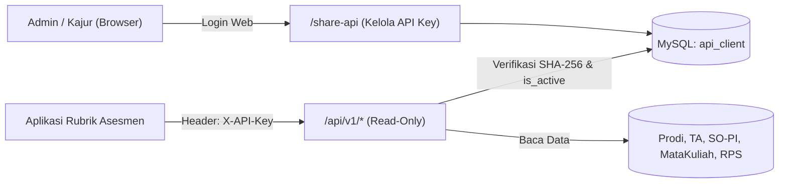

# Rencana Fitur REST API SO-PI & Mata Kuliah + Halaman "Share API"

> Status: **PLAN** (belum diimplementasikan)
> Tujuan: Menyediakan REST API (read-only) untuk data **Student Outcome (SO)**, **Performance Indicator (PI)**, **Proficiency Level**, serta **Mata Kuliah & Pemetaan RPS/Rubrik Asesmen** agar dapat ditarik oleh **Aplikasi Rubrik Asesmen** (dan sistem internal organisasi lainnya). Akses API dikelola oleh **Admin (Kajur)** dari halaman web **Share API**.

> [!NOTE]
> **Konteks & Keputusan yang Sudah Ditetapkan:**
> 1. **Konsumen API:** Sistem internal organisasi (khususnya **Aplikasi Rubrik Asesmen**) yang juga dikelola oleh tim internal → keamanan dibuat **pragmatis & ringkas** (satu tabel `api_client`, tanpa OAuth/IP allowlist/rate-limiter berlapis).
> 2. **Cakupan Data:** Master **SO, PI, Proficiency Level** + **Mata Kuliah & Pemetaan CPL/SO-PI/Komponen Rubrik dari RPS** (menggunakan kembali logika export JSON yang sudah ada di `routes/rps.py`).
> 3. **Autentikasi:** Header `X-API-Key: psk_...`.
> 4. **Independensi:** Rencana ini berdiri sendiri (tidak bergantung pada `jwt-login.md`) dan tidak mengubah konfigurasi Nginx.

---

## 1. Kondisi Saat Ini (Hasil Analisis Kode)

| Komponen | Keterangan di Codebase |
|---|---|
| Master SO-PI | `models/so_pi.py`: `StudentOutcome`, `PerformanceIndicator`, `ProficiencyLevel`, helper `so_sort_key()`. |
| Master Mata Kuliah & TA | `models/matakuliah.py` (`MataKuliah`), `models/tahun_ajaran.py` (`TahunAjaran`, flag `is_aktif`), `models/prodi.py` (`Prodi`). |
| Pemetaan MK ↔ SO-PI & Rubrik | Tersimpan di `models/rps.py` (`RPS.tp_data` dan `RPS.kriteria_penilaian`). |
| **Temuan penting di `routes/rps.py`** | Sudah ada helper `_build_course_json(rps)` (baris 977) dan route `/<int:id>/export-json` (baris 1424) yang menghasilkan format `static/data/course_dummy.json` untuk **Aplikasi Rubrik Asesmen** (`course_code`, `categories`, `components`, `criteria`, `cpls`, `assessment_rubric`). Helper ini tinggal dipindahkan/dipakai bersama oleh REST API! |
| Bug kecil di `_build_course_json` | Saat ini `_load_so_pi_data()` dipanggil tanpa `prodi_id` dan `study_program` masih hardcode `'RKS'`. Saat diekspos ke API, ini sekalian diperbaiki menjadi `rps.prodi.kode` dan `_load_so_pi_data(rps.prodi_id)`. |

---

## 2. Arsitektur & Mekanisme Autentikasi

### 2.1 Prinsip Desain
1. **Header `X-API-Key`:** Setiap aplikasi internal diberi 1 API key dari menu **Share API**.
2. **Read-Only (`GET` saja):** Aman dari modifikasi data tidak sengaja.
3. **Key Disimpan Ter-hash (`SHA-256`):** Di database hanya disimpan `key_prefix` (8 karakter awal untuk identifikasi di tabel UI) dan `key_hash`. Plaintext key hanya muncul **sekali** saat dibuat atau di-regenerate.
4. **Stateless & Bebas CSRF:** Blueprint `/api/v1` di-`csrf.exempt` dan tidak memakai session cookie web.

### 2.2 Alur Sistem



### 2.3 Format API Key
```text
psk_3f9a1c2b_Yk2nQ8...(acak 32 byte base64url)
```
- `key_prefix`: `psk_3f9a1c2b` (ditampilkan di halaman admin).
- `key_hash`: `sha256(full_key)` (dibandingkan dengan `hmac.compare_digest`).

---

## 3. Desain Endpoint REST API (`/api/v1`)

Base URL: `https://<domain>/prodisync/api/v1`
Semua request wajib menyertakan header:
```http
X-API-Key: psk_<prefix>_<secret>
```

### 3.1 Daftar Endpoint

| Method | Endpoint | Kegunaan untuk Aplikasi Rubrik Asesmen |
|---|---|---|
| `GET` | `/api/v1/ping` | Tes koneksi & validasi key (`{"status": "ok", "client": "Aplikasi Rubrik"}`) |
| `GET` | `/api/v1/prodi` | Daftar prodi aktif (`kode`, `nama`, `jenjang`) + Tahun Ajaran aktif saat ini |
| `GET` | `/api/v1/proficiency-levels` | Master level 1–5 IABEE beserta labelnya |
| `GET` | `/api/v1/prodi/{kode}/so` | Daftar SO di prodi tsb. Query param: `?status=active\|inactive\|all`, `?include=pi` |
| `GET` | `/api/v1/prodi/{kode}/so/{so_code}` | Detail 1 SO beserta daftar PI-nya |
| `GET` | `/api/v1/prodi/{kode}/pi` | Daftar seluruh PI (flat) di prodi tsb. Query param: `?so_code=SO1`, `?level=2` |
| `GET` | `/api/v1/prodi/{kode}/so-pi` | **Ekspor lengkap SO → PI + Level** dalam 1 panggilan |
| `GET` | `/api/v1/prodi/{kode}/matakuliah` | Katalog Mata Kuliah prodi + ringkasan SO-PI yang dipetakan di RPS. Query param: `?semester=1..8`, `?kurikulum=...`, `?ta=2025/2026 Ganjil` (default: TA aktif), `?rps_status=approved\|all` (default: `approved`) |
| `GET` | `/api/v1/prodi/{kode}/matakuliah/{kode_mk}/rubrik` | **Payload lengkap Rubrik Asesmen 1 MK** (format identik dengan `export-json` / `course_dummy.json`: informasi MK, komponen penilaian, bobot, CPL/CLO, pemetaan SO-PI, dan deskripsi rubrik level 1–5). Query param: `?ta=...`, `?rps_status=approved\|all` |
| `GET` | `/api/v1/prodi/{kode}/rubrik-courses` | **Bulk sync untuk Aplikasi Rubrik Asesmen:** daftar seluruh MK yang memiliki RPS (`approved` by default) pada Tahun Ajaran aktif beserta payload rubrik & pemetaan SO-PI-nya sekaligus |

### 3.2 Contoh Payload Endpoint Mata Kuliah & Rubrik

#### A. `GET /api/v1/prodi/RKS/matakuliah?rps_status=approved`
```json
{
  "data": [
    {
      "kode": "RKS101",
      "nama": "Pengantar Keamanan Siber",
      "sks": 3,
      "semester": 1,
      "tipe": "wajib",
      "kurikulum": "v2 IABEE",
      "kategori": "system",
      "prasyarat": [],
      "rps": {
        "tahun_ajaran": "2025/2026 Ganjil",
        "status": "approved",
        "updated_at": "2026-10-15T09:30:00",
        "so_codes": ["SO1", "SO2"],
        "pi_codes": ["PI-01.1", "PI-01.2", "PI-02.1"],
        "clo_count": 4
      }
    }
  ],
  "meta": {
    "prodi": "RKS",
    "tahun_ajaran": "2025/2026 Ganjil",
    "rps_status_filter": "approved",
    "count": 1
  }
}
```

#### B. `GET /api/v1/prodi/RKS/matakuliah/RKS101/rubrik`
Mengembalikan struktur `_build_course_json(rps)` yang sudah disempurnakan:
```json
{
  "data": {
    "course_code": "RKS101",
    "course_name": "Pengantar Keamanan Siber",
    "sks": 3,
    "semester_ke": 1,
    "semester": "2025/2026 Ganjil",
    "study_program": "RKS",
    "rps_status": "approved",
    "is_pbl": false,
    "target_attainment": 60,
    "cpls": [
      {
        "code": "CPL1",
        "description": "Mahasiswa mampu menjelaskan konsep dasar...",
        "proficiency_level": 2,
        "so_codes": ["SO1"],
        "pi_codes": ["PI-01.1"],
        "so_pi_pairs": [{"so_code": "SO1", "pi_code": "PI-01.1", "level": 2}],
        "assessment_rubric": {
          "PI-01.1": {
            "1": "Mengenal istilah dasar",
            "2": "Mampu menjelaskan konsep dengan tepat"
          }
        }
      }
    ],
    "categories": [
      {
        "key": "tugas",
        "label": "Tugas",
        "components": [
          {
            "name": "Tugas Mandiri 1",
            "weight": 15,
            "cpl_pis": [],
            "criteria": [ ... ]
          }
        ]
      }
    ]
  },
  "meta": {
    "prodi": "RKS",
    "tahun_ajaran": "2025/2026 Ganjil"
  }
}
```
> **Catatan Kompatibilitas:** Semua key yang sudah ada di `_build_course_json` (`course_code`, `course_name`, `sks`, `semester`, `study_program`, `is_pbl`, `target_attainment`, `categories`, `cpls`) **dipertahankan 100%** agar langsung cocok dengan parser Aplikasi Rubrik Asesmen, ditambah field `pi_codes` dan `so_pi_pairs` di tiap CPL untuk memudahkan pemetaan otomatis.

---

## 4. Desain Halaman Admin "Share API" (`/share-api`)

- **Akses:** Hanya Kajur / Admin (`@login_required` + `@kajur_required`).
- **Posisi Menu:** Sidebar `templates/base.html` di bagian administrasi Kajur (sejajar dengan menu Kelola Prodi / Tahun Ajaran).
- **Tampilan (1 halaman ringkas `templates/share_api/index.html`):**
  1. **Banner Key Baru (Flash/Modal Sekali Tampil):** Muncul tepat setelah membuat atau me-regenerate key, dilengkapi tombol **Copy Key** dan peringatan bahwa key hanya ditampilkan sekali.
  2. **Tabel Daftar Aplikasi Konsumen:**
     - Nama Aplikasi (mis. *Aplikasi Rubrik Asesmen*) & Keterangan
     - Key Prefix (`psk_3f9a1c2b...`)
     - Status (`Aktif` / `Nonaktif`)
     - Terakhir Diakses (waktu & IP) + Total Request
     - Tombol Aksi: **Edit**, **Regenerate Key**, **Aktif/Nonaktif**, **Hapus**
  3. **Panel Dokumentasi & Contoh Pemanggilan (Interactive Docs):**
     - Daftar endpoint SO-PI & Mata Kuliah/Rubrik.
     - Contoh perintah `curl -H "X-API-Key: <key>" ...` dengan tombol copy supaya mudah dites langsung.

---

## 5. Model Database

Satu tabel baru `api_client` di `models/api_client.py`:

| Kolom | Tipe | Keterangan |
|---|---|---|
| `id` | `Integer` PK | ID internal |
| `name` | `String(100)` | Nama aplikasi (mis. "Aplikasi Rubrik Asesmen") |
| `description` | `String(255)` | Catatan/tujuan |
| `key_prefix` | `String(20)` Unique | Contoh: `psk_3f9a1c2b` (untuk lookup cepat & tampilan UI) |
| `key_hash` | `String(64)` | SHA-256 hex dari full API key |
| `is_active` | `Boolean` | Default `True` |
| `last_used_at` | `DateTime` | Waktu akses terakhir |
| `last_used_ip` | `String(45)` | IP terakhir (dari `X-Real-IP` / `remote_addr`) |
| `request_count` | `Integer` | Counter pemakaian (default `0`) |
| `created_by` | `Integer` FK(`user.id`) | Admin pembuat |
| `created_at` / `updated_at` | `DateTime` | Timestamp standar |

---

## 6. File yang Perlu Diubah & Dibuat

### 6.1 File Baru
| File | Deskripsi |
|---|---|
| `models/api_client.py` | Model `ApiClient` + method `generate_key()`, `verify_key(raw_key)` |
| `migrations/versions/0007_add_api_client.py` | Migrasi Alembic untuk tabel `api_client` |
| `utils/api_auth.py` | Decorator `@api_key_required` (cek header `X-API-Key`, validasi hash & `is_active`, update `last_used_at` & `request_count`) |
| `utils/serializers.py` | Serializer JSON untuk Prodi, SO, PI, ProficiencyLevel, MataKuliah, dan ekstraksi `_build_course_json` dari `routes/rps.py` |
| `routes/api_v1.py` | Blueprint `api_v1` (`url_prefix='/api/v1'`) berisi 10 endpoint pada §3.1 |
| `routes/share_api.py` | Blueprint `share_api` (`url_prefix='/share-api'`) untuk CRUD API key oleh Kajur |
| `templates/share_api/index.html` | UI halaman Share API + modal tambah/edit + modal copy key + dokumentasi endpoint |

### 6.2 File yang Diubah
| File | Perubahan |
|---|---|
| [models/\_\_init\_\_.py](models/__init__.py) | Export `ApiClient` |
| [routes/\_\_init\_\_.py](routes/__init__.py) | Export `api_v1_bp` dan `share_api_bp` |
| [routes/rps.py](routes/rps.py) | Gunakan fungsi `_build_course_json` dari `utils/serializers.py` (agar satu sumber logika antara tombol Export JSON di web dan REST API) + perbaiki `study_program` & filter `prodi_id` |
| [app.py](app.py) | Register `api_v1_bp` (dengan `csrf.exempt(api_v1_bp)`) dan `share_api_bp` |
| [templates/base.html](templates/base.html) | Tambah link menu **Share API** pada sidebar bagian Kajur |
| [arsitektur-sistem.md](arsitektur-sistem.md) & [README.md](README.md) | Tambah dokumentasi ringkas REST API & menu Share API |

---

## 7. Breakdown Task Implementasi

### Fase 1 — Database & Autentikasi API Key
- [ ] **T1.1** Buat model `ApiClient` di `models/api_client.py` beserta fungsi generator key (`psk_<8hex>_<secret>`) dan verifikasi SHA-256 (`hmac.compare_digest`).
- [ ] **T1.2** Buat file migrasi Alembic `migrations/versions/0007_add_api_client.py` dan jalankan `flask db upgrade`.
- [ ] **T1.3** Buat decorator `@api_key_required` di `utils/api_auth.py` yang membaca header `X-API-Key` dan mengembalikan JSON `401` jika tidak valid/nonaktif.

### Fase 2 — Serializer & Endpoint REST API (`/api/v1`)
- [ ] **T2.1** Buat `utils/serializers.py`:
  - Serializer `Prodi`, `TahunAjaran`, `StudentOutcome`, `PerformanceIndicator`, `ProficiencyLevel`, `MataKuliah`.
  - Pindahkan & rapikan `_build_course_json(rps)` dari `routes/rps.py` supaya `study_program` otomatis mengikuti `rps.prodi.kode`, `_load_so_pi_data(rps.prodi_id)` terfilter per prodi, dan menyertakan `pi_codes` & `so_pi_pairs`.
- [ ] **T2.2** Buat `routes/api_v1.py` untuk endpoint SO-PI (`/ping`, `/prodi`, `/proficiency-levels`, `/prodi/<kode>/so`, `/prodi/<kode>/so/<so_code>`, `/prodi/<kode>/pi`, `/prodi/<kode>/so-pi`).
- [ ] **T2.3** Tambahkan endpoint Mata Kuliah & Rubrik di `routes/api_v1.py` (`/prodi/<kode>/matakuliah`, `/prodi/<kode>/matakuliah/<kode_mk>/rubrik`, `/prodi/<kode>/rubrik-courses`) dengan dukungan filter `?ta=` dan `?rps_status=approved|all`.
- [ ] **T2.4** Daftarkan `api_v1_bp` di `app.py` dengan `csrf.exempt` serta penanganan error JSON (`401`, `404`, `405`, `500`) khusus prefix `/api/`.

### Fase 3 — Halaman Admin "Share API" (`/share-api`)
- [ ] **T3.1** Buat `routes/share_api.py` (`@login_required`, `@kajur_required`) dengan aksi: daftar client, tambah client, edit nama/deskripsi, regenerate key, toggle aktif/nonaktif, dan hapus client.
- [ ] **T3.2** Buat `templates/share_api/index.html` dengan:
  - Modal tampil key baru sekali + tombol copy,
  - Tabel daftar client & statistik pemakaian (`request_count`, `last_used_at`, `last_used_ip`),
  - Cheat-sheet / dokumentasi endpoint lengkap beserta contoh `curl` `X-API-Key`.
- [ ] **T3.3** Tambahkan menu **Share API** di `templates/base.html` (khusus `current_user.is_kajur`).

### Fase 4 — Pengujian & Dokumentasi
- [ ] **T4.1** Uji coba pembuatan key dari UI Share API, toggle nonaktif, regenerate key, dan hapus key.
- [ ] **T4.2** Uji semua endpoint `/api/v1/*` dengan `X-API-Key` (skenario sukses `200`, key salah `401`, prodi/MK tidak ditemukan `404`).
- [ ] **T4.3** Pastikan tombol **Export JSON** lama di halaman RPS tetap berjalan normal memakai fungsi bersama di `utils/serializers.py`.
- [ ] **T4.4** Perbarui `arsitektur-sistem.md` dan `README.md`.
